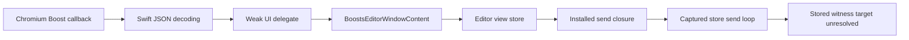

# Arc 1.172.1 analysis dossier

Snapshot assembled **2026-11-08**, Europe/Berlin; fixed-version identity,
signed attributes and selector completion observations added **2026-11-09**.
Selector coordinate and cleanup follow-up verified **2026-11-13**.
This dossier consolidates the supplied
**Arc 1.172.1 / build 90370 DMG** investigation. It is a coverage map and an
explanation of recovered implementation paths; full Arc behavior is **not yet
established**. Native analyses, resource searches and owned compiler tests have
answered several narrow questions, while reducer effects, persistence, final
UI rendering and broader browser subsystems remain open.

This snapshot uses retained observations only. Arc, its helpers and shipped
JavaScript were not executed in these offline passes. There are no observations
of a signed-in account, user profile, service response or live Arc UI. Source
built fixtures were compiled and statically inspected; their known source is
an oracle for tool verification, not evidence of Arc's runtime state.

## Target identity and evidence boundaries

| Input                       |       Bytes | SHA-256                                                            |
| --------------------------- | ----------: | ------------------------------------------------------------------ |
| Supplied DMG                | 462,320,856 | `d1d966face8fd0a0a6f7321bc50dbac633a3df1cea0c5afc8d43e2e43e12b778` |
| Universal main executable   | 167,563,024 | `3cb06fbc4736f01baa4e002fcf22fbfc230452925dee15d876b23f8c385f8e63` |
| Derived ARM64 main          |  80,498,448 | `6056139d78d9be98d2da8e64b2e7aab7c2946a130df392fa19af39a77963d578` |
| Universal ArcCore carrier   | 507,526,464 | `aacb29669c253804ed263f5105a9869dcda0b6a083a58ef7b96bb10da4287dd5` |
| Derived ARM64 ArcCore       | 242,072,896 | `d5c04f2d2a6839cdd2360192950d06f4c085ff2aead2e7f10206b6e7fd7bd80e` |
| Main Chromium resource pack |  24,999,244 | `69989f28e4c839975fbde1c300b32cc58e1dff332729432ddbd21a26e753a49f` |

The retained app-plist receipt records bundle identifier
**`company.thebrowser.Browser`**. Public extraction commitments cover **1,113
regular files / 916,318,369 bytes**. The fresh extraction after temporary inputs
were cleared matches the earlier file commitments. See [original extraction][E01],
[fresh extraction][E35] and the
[identity/recovery receipt](arc-core-loader-2026-11-08/input-recovery.json).
These hashes establish artifact identity, not publisher authenticity.

Earlier reports on installed **1.171.0** remain historical. Their addresses,
resource IDs, thresholds and behavior are not transferred merely because a
feature has the same name. Exact Evidence IDs, artifact identities, operations,
profiles and file hashes for this dossier are in the
[evidence index](arc-analysis-dossier-2026-11-08/evidence-index.json).

Native observations often use explicit **1-, 15- or 60-second** analysis
policies and caller-selected entry seeds. A positive instruction or metadata
observation remains useful in a stable partial Program; an empty caller list
or missing function in that Program does not establish global absence.
Recovered pseudocode is decompiler output, not original Swift/C++ source.

## Recovered implementation layers

| Layer                      | What the evidence establishes                                                                                                                                                                                                                                  | Boundary                                                                                                                             |
| -------------------------- | -------------------------------------------------------------------------------------------------------------------------------------------------------------------------------------------------------------------------------------------------------------- | ------------------------------------------------------------------------------------------------------------------------------------ |
| Native editor UI/state     | The selected editor initializer creates a view store, SwiftUI state/observed-object storage, subscriptions and cached web-content/browser pairs. [E15][E15]                                                                                                    | This does not recover the whole window hierarchy or all Arc UI.                                                                      |
| Web-content bridge         | `WebContentChromium` implements the selected callback JavaScript route and weak UI-delegate storage. [E07][E07], [E12][E12]                                                                                                                                    | The concrete runtime object/factory choice is not observed.                                                                          |
| Native store/reducer       | The editor handoff reaches an installed send closure and captured store's generic send loop. A local `BoostsEditor: Reducer` conformance and reducer witness are identified. [E16][E16], [E18][E18], [E22][E22]                                                | The stored instance may be wrapped; static conformance alone is not an instance assignment. Nested case recovery remains incomplete. |
| Bundled selector source    | `ARC_BoostsEditor.bundle` contains a 11,068-byte `SelectorPicker.js`, retained in the fixed-version loose-script analysis. [E36][E36]                                                                                                                          | Source presence does not prove loading into a particular page/world.                                                                 |
| Native selector completion | Selected async entries schedule cached-source evaluation, continue after releasing a bootstrap error, and reach two `Published` value-update branches. An exact indexed hover-class query returns 17 vtable rows / two resolved targets. [E71][E71]–[E78][E78] | The initiating event, concrete receiver, unsupported slots and final native drawing remain unresolved.                               |
| Packed extension sources   | Public pack reads recover manifests and inert Google Docs/Slack/Web Store/Notion sources with exact resource identities. [E28][E28]–[E32][E32]                                                                                                                 | Three selected filename-to-ID mappings are corroborated below; activation remains unobserved.                                        |
| ArcCore native support     | Selected code supplies the manifest resource, brands it, parses/registers a component and conditionally reaches an activation handoff. [E26][E26], [E33][E33], [E65][E65]–[E69][E69]                                                                           | Runtime flags/overrides and activation remain unobserved; this is not complete recovery of ArcCore or Chromium.                      |

No global browser architecture or process-isolation claim is inferred solely
from framework names, imports or the package inventory.

## Feature coverage checklist

“Answered” below closes the stated narrow static question. “Partial” means a
route has useful recovered links but lacks a required decision, state effect or
output. “Unassessed” means this investigation has not traced that subsystem.

| Question                                                                                                          | Status                                   | Established result                                                                                                                                                                                                                            | Evidence still needed                                                                                                                           |
| ----------------------------------------------------------------------------------------------------------------- | ---------------------------------------- | --------------------------------------------------------------------------------------------------------------------------------------------------------------------------------------------------------------------------------------------- | ----------------------------------------------------------------------------------------------------------------------------------------------- |
| Which exact package/build is under analysis?                                                                      | Answered                                 | Fixed DMG, main/Core slices and regular-file commitments above.                                                                                                                                                                               | No additional identity evidence for these selected bytes.                                                                                       |
| Which local UI-delegate implementation handles Boost commands?                                                    | Answered, static assignment              | Editor delegate has substantive code; the frame's corresponding slot is a return stub. [E05][E05], [E06][E06], [E08][E08]                                                                                                                     | Runtime instance selection remains a separate question.                                                                                         |
| How does a decoded command reach native state dispatch?                                                           | Partial                                  | Weak delegate → editor → `_viewStore` → installed send closure → captured store send. [E04][E04], [E17][E17], [E18][E18]                                                                                                                      | Concrete stored reducer/wrapper binding and every command's state/effect path.                                                                  |
| What are the four command type strings?                                                                           | Answered, static derivation              | Fresh comparison constants encode `v2-load-css`, `v2-edit-css`, `v2-load-js`, `v2-edit-js`. [E03][E03]                                                                                                                                        | Actual submitted-message behavior is unobserved.                                                                                                |
| What are the exact JSON key spellings on 1.172.1?                                                                 | Answered, static witness implementations | Fresh metadata-selected getters return `boostId`, `type`, `data` and `contents`. [E38][E38]–[E43][E43]                                                                                                                                        | No additional spelling evidence; runtime witness population and submitted-message behavior remain unobserved.                                   |
| Which JavaScript evaluator does the selected selector route use?                                                  | Answered, selected implementation        | Callback `executeJavascript:reason:completion:` path, main-actor completion, String cast and JSON decode. [E11][E11]–[E14][E14]                                                                                                               | Runtime world, frame and concrete web-view instance.                                                                                            |
| How is the selector library supplied?                                                                             | Partial                                  | Resource loader/cache, async scheduling, cached-source forwarding and a caller that releases a bootstrap error before continuing are recovered. [E25][E25], [E72][E72]–[E75][E75]                                                             | The initiating event, next-stage implementation, concrete page/world, per-page lifetime and actual evaluation outcome.                          |
| How are points/rectangles transformed and drawn?                                                                  | Partial                                  | Source wrappers forward DOM rectangle components. The selected native query scales input by the reciprocal getter value, builds `getHoveredElement({x: …, y: …})`, then scales its successful rectangle result forward. [E81][E81]–[E88][E88] | Concrete receiver/value interpretation, final native coordinate spaces, origin/scroll/zoom handling, live getter values and overlay rendering.  |
| How does editor browser/web-content state change?                                                                 | Partial                                  | Internal CSS/JS URL construction and conditional cache-release path are recovered. [E20][E20], [E21][E21]                                                                                                                                     | URL handlers, concrete manager methods and complete state transitions.                                                                          |
| How are Boost edits stored and restored?                                                                          | Unresolved                               | The generic send route is known; no durable end-to-end persistence path is established.                                                                                                                                                       | Command → mutation → storage write → reload/readback, including failures and identity association.                                              |
| How does the Google Docs helper inject its page code?                                                             | Partial                                  | Manifest scopes, extension URL creation, appended script, conditional canvas-annotation script construction. [E28][E28]–[E30][E30]                                                                                                            | Actual native registration and page/CSP/Trusted Types outcomes.                                                                                 |
| How is the internal extension branded/registered?                                                                 | Partial                                  | First branding replacement, override-aware manifest read, parse, gated vector registration and conditional creation/identifier-check/activation handoff are traced. [E26][E26], [E44][E44]–[E49][E49], [E65][E65]–[E69][E69]                  | Remaining identifier helpers, runtime override/brand/policy state and actual activation or service-worker execution.                            |
| Sidebar/tabs/spaces/navigation, account/sync, downloads/history, storage security and general browser networking? | Unassessed as end-to-end features        | Package/type/resource observations may exist.                                                                                                                                                                                                 | Entry points, decisions, state ownership, durable effects, outputs and failure paths for each subsystem.                                        |
| Which component identities and signed attributes ship in this fixed build?                                        | Answered, selected static attributes     | All 28 inventory-selected Mach-O carriers have signature Evidence; 22 executable-bearing bundle plists identify the fixed version and declarations. 24 of 28 carriers, including the main, report hardened runtime. [E50][E50]–[E64][E64]     | Filesystem resource-seal/trust/notarization validation, independent universal-slice equivalence and actual runtime isolation remain unassessed. |

## Boost command path

For the selected static implementations, the recovered handoff is:

The decoder's success path obtains the weak UI delegate and invokes offset
**`+0x100`**. Metadata and assignment code identify the editor's corresponding
slot as **`0x1012d2ddc` → `0x1012d2b84`**. The frame implementation at
**`0x100006b90`** returns immediately. The editor handler stops if its optional
Boost IDE object is absent; otherwise it translates one of four variants and
hands off its payload. [E04][E04]–[E08][E08]

The field originally called an unnamed dispatch object is **`_viewStore`** at
editor offset **`0x08`**. Initialization stores a constructor result there.
The view-store constructor installs **`0x1008ca400`** and context at **`+0x28`**;
that context retains the incoming store at **`+0x18`**. The closure reaches
**`0x1008c7c34` → `0x10088d940`**. The generic routine appends an action and calls
through a stored witness at **`0x10088de88`**. Its observed body has **806
instructions / 3,224 bytes**. The direct target resolver explicitly leaves that
call unresolved. High-pcode also retains truncation; complete machine listings
must not be substituted for complete value flow. [E15][E15]–[E19][E19]

New selected metadata identifies **`BoostsEditor: Reducer`**, conformance
**`0x103788ae8`**, table **`0x1046270d8`**, with a reduce witness at
**`0x1012a9870`** forwarding to **`0x1012a571c`**. This narrows the implementation
candidate without proving that the captured runtime store holds this exact
unwrapped table. The nested outlined tag helper **`0x1012b2860`** precedes an
unrecovered signed-word jump at **`0x1012a5bc8`**. Missing case bodies prevent
closing all CSS/JavaScript effects. [E22][E22]–[E24][E24]

A later public byte read retains **112 bytes / all 28 signed words** in the
selected table. It agrees with the original 24-word prefix and removes that
read-coverage gap. Assigning those entries to the active child value still
requires the caller-type/projection proof; the read does not repair ownership
or establish every case effect. [Complete table read][E70]

The response helper **`0x100576028`** uses JSONEncoder and dispatches either
`sendResponse:jsonString:` or `sendErrorResponse:jsonString:`. The explicit
error variant and JSONEncoder-failure fallback follow different paths; they
must not be collapsed into one generic “error response” behavior. [E09][E09]

The fresh command-type constants are decoded in
[the small-String derivation](arc-analysis-dossier-2026-11-08/command-type-derivation.json).
Fresh `CodingKey.stringValue` requirement metadata selects request getter
**`0x10053c4ac`** and payload getter **`0x1004ca7a8`**. The request getter reads
a byte tag and returns small-String words for **`boostId`**, **`type`** and
**`data`**; the payload getter returns **`contents`**. Exact instructions and
pseudocode agree. This closes the former spelling caveat on the supplied
1.172.1 bytes. The static resilient records still say **`not_instantiated`**:
record ordinal 2 is not a populated runtime slot. The seeded, one-second
partial Program completed seven public calls without error, exported its
Evidence, closed successfully and retained an empty-descendant verifier receipt.
See [the getter derivation](arc-analysis-dossier-2026-11-08/codingkey-verification.json).
No command was sent. [E38][E38]–[E43][E43]

## Selector execution, geometry and lifecycle

`WebContentsAdaptor: SelectorPickerWebContents` is identified by metadata.
Its shipped four-word template retains a hole, async descriptor
**`0x10378c758`**, and scale getter **`0x1012fa5e0`**. The template is distinct
from an instantiated runtime witness table. [E10][E10], [E37][E37]

The selected async entry **`0x1012fa578`** switches through main-actor code to
**`0x1012fa3a0`**, handles missing web content and forwards into the shared
execution path. The selected implementation's callback closure reaches
**`0x100557874`**, then `JavaScriptExecuting` slot 2 and
**`0x10054eb6c` → `0x100548344`**. That code checks execution availability,
holds an `emitFreezingVote:` token and calls the native web view's
**`executeJavascript:reason:completion:`**. Completion is marshalled to the main
actor, then the selector continuation checks String presence/type and invokes
JSONDecoder. The distinct slot-3/DevTools async route is not substituted for this
callback route. [E11][E11]–[E14][E14]

A later consumer **`0x1012e560c`** calls `_swift_once` for source initializer
**`0x1012e626c`**, reads the cached String words and forwards them through a
captured async descriptor. This establishes source forwarding beyond merely
finding the bundled file. It does not establish which live page/world evaluates
it or that evaluation succeeds. Source filename/line constants used by the
native executor are debug context, not isolated-world identifiers. [E25][E25]

Retained async entry **`0x1012e55f0`** stores its incoming arguments and
schedules that cached-source consumer through `_swift_task_switch`. Its
continuation **`0x1012e56b8`** deallocates the child task context and selects
**`0x1012e5714`** or **`0x1012e5758`** according to returned X20. Another selected
caller **`0x1012e4ec4`** schedules the same consumer with continuation
**`0x1012e4f58`**. That continuation explicitly releases a nonzero error value
through `_swift_errorRelease`, then schedules **`0x1012e5788`** in either case.
On this selected path bootstrap failure is released and the enclosing operation
proceeds; the operation's initiating event and the next-stage body remain
untraced here. No live evaluation result is inferred. [E72][E72]–[E75][E75]

The retained next continuation **`0x1012e4fd4`** routes to
**`0x1012e5088`** or **`0x1012e5148`**. These pass four eight-byte words plus a
flag, or four zero words plus flag **1**, through Combine's `Published` enclosing
instance setter with the same keypaths. Both clear a field addressed through
the global rendered as `_status`; if its prior unsigned byte exceeds **1**,
they call **`0x1012e4d6c`**. These observations establish selected value-update
paths, not the complete value type, concrete receiver or visible rendering.
[E76][E76]–[E78][E78]

Exact indexed-class selection now establishes **`HoveredElementTracker`** at
descriptor **`0x103d7bcb4`** without spending admission on earlier classes.
The query examines **11,125 / 11,125** type-index entries, finds one matching
descriptor and no unresolved index identities, and retains **17 vtable rows**.
Only metadata word slots **21** → **`0x1012e4cec`** and **30** →
**`0x1012e4d6c`** resolve to native targets; the other 15 rows remain partial.
Word slots are not source method ordinals, and the unresolved rows are not all
labeled async. The second target agrees by address with the helper in the
publication paths; it does not prove the concrete runtime receiver. No class
metadata was instantiated. That utility retest did not analyze the target bodies;
the Nov13 native follow-up below does. See
[the selector report](arc-selector-rendering-2026-11-09.md).
[E71][E71]

The exact fixed-version JavaScript wrappers use `document.elementFromPoint`,
`getBoundingClientRect` and `document.querySelectorAll`. Hover output contains
rectangle components and a hash; `rectsForSelector` forwards `left`, `top`,
`width`, `height`. The candidate source filters matches at **100**. These are
analyst source observations bound to the recovered module's digest in
[the source-facts receipt](arc-analysis-dossier-2026-11-08/selector-source-facts.json),
not a complete semantic trace or DOM execution. [E36][E36]

The native scale getter defaults to **1.0** without web content and otherwise
reads a feature value through a virtual getter, converting Float to Double.
The selector request applies reciprocal scaling to lookup coordinates. The
final AppKit/SwiftUI overlay transform, drawing and event lifetime remain open.
An earlier installed-build native candidate threshold of 500 is not promoted
as a verified fixed-build threshold here.

Editor URL builder **`0x1012d3b04`** reads identifier/mode via view-store
keypaths. With an identifier, raw mode **1** selects `arc://boost/v2/js/`;
another admitted branch selects `arc://boost/v2/css/`; raw mode **2/3** produces
no URL. The URL route handlers remain unknown. A separate weak subscription
callback reaches **`0x1012d3478`**: with a live editor/native object and mode
2/3, it calls a manager slot and zeros/releases cached browser and web-content
pairs. That is a conditional static cleanup path, not an observed window close.
The separate Combine notification pipeline is not the command-send closure.
[E20][E20], [E21][E21]

## Packaged extensions and ArcCore boundary

Fixed-version manifests/sources are recovered from the main pack:

| Resource | Recovered material                                                                                                                            | Evidence   |
| -------- | --------------------------------------------------------------------------------------------------------------------------------------------- | ---------- |
| 15548    | Google Docs helper manifest: document URLs, all frames, document_start and exposed `gdocs_script.js`                                          | [E28][E28] |
| 15865    | Creates an extension URL for `gdocs_script.js` and appends a script element                                                                   | [E29][E29] |
| 15866    | Builds the `_docs_annotate_canvas_by_ext` write, using runtime ID or currentScript URL; Trusted Types/eval or appended inline script branches | [E30][E30] |
| 15558    | `<APP_NAME> Internal Extension` MV3 manifest; background service worker and selected HTTPS host permissions                                   | [E31][E31] |
| 15901    | Slack/Web Store/Notion site dispatch; CSS/script requests and branding input from the first manifest-name word                                | [E32][E32] |

The selected pack searches examine all **5,439 canonical entries**, accounting
for **382 aliases**, but only for their selected literal queries. This is not
complete feature analysis of every resource. Fresh loaded native byte reads
corroborate **`reading_mode_gdocs_helper/content.js` → 15865** at
**`0xe1d2370`**, **`reading_mode_gdocs_helper/gdocs_script.js` → 15866** at
**`0xe1d2390`**, and **`arc_internal_extension/background.js` → 15901** at
**`0xe1d2430`**. Each record contains the retained path pointer and resource ID;
separate public byte reads retain the exact pointed-to strings. These close
three filename/body associations, while actual page/extension activation and Google Docs native
registration remain open. The
[byte derivation](arc-analysis-dossier-2026-11-08/resource-path-derivation.json)
records the offsets and decoding. [E46][E46]–[E49][E49]
The limited semantic traces explicitly remain partial, so the source-level
interpretations above are not mislabeled as complete semantic recovery.

The selected ArcCore function **`0x4448490`** requests resource **15558**, selects
`Arc` or `Dia` from a stored flag and passes `<APP_NAME>`/length 10 plus the
selected three-byte name to **`0x31e54dc`** before a handoff with
`arc_internal_extension` to **`0x34b133c`**. The replacement callee searches and
compares the supplied substring, moves the replacement and trailing bytes,
updates the size and returns after the first match. This establishes first
placeholder replacement on that selected call path. The resource-read helper
**`0x2299440`** first permits a virtual override, then falls back to the resource
lookup; the shipped pack is therefore not the only possible runtime source.
Actual chosen flag/override values remain unobserved. [E26][E26], [E44][E44], [E45][E45]

The handoff calls **`0x34b13e0`**, which retains a parse-failure branch logging
`Failed to parse extension manifest.`. On success **`0x34b14b4`** resolves a
relative root through path-service key **`0x3ed`**, obtains an identifier, applies
acceptance checks and appends a **72-byte** entry to its vector. The path-service
enum name and policy results are not inferred from their numeric values.
Under an owning-state flag, **`0x32f233c`** attempts construction, logs a failure
if no object is returned, compares the created object's identifier with the
stored identifier and hands it to **`0x32f406c`** on equality. This is a selected
conditional activation path in code, not observed activation. [E65][E65]–[E67][E67]

Identifier helper **`0x31e5204`** selects the manifest field **`key`**, calls
**`0x31e52b0`** and **`0x2d8c700`**, and preserves missing/invalid-input empty
results. Those untraced callees are not labeled with a decoding/hash algorithm
and no final extension ID is assigned. The full
[Core registration/resource report](arc-core-loader-2026-11-08.md) also retains
DataPack canonical/alias lookup, raw/gzip/Brotli conversion, resource-request
failure diagnostics and their selected ownership. The final loader session
completed **15/15 calls**, exported and explicitly closed with verified empty
descendants. Its **44-record/five-bundle** audit and 14 selected finding checks
do not close actual runtime flags, deeper activation effects, Google Docs native
registration or page/CSP/Trusted Types outcomes. [E68][E68], [E69][E69]

The separate function **`0x4446538`** contains native URL-loader decisions,
`[SentryTunnel]` logging and conditional extension-ID comparisons. Its source
unit name and nearby strings do not make it the manifest loader or establish
that its intercepted IDs belong to either recovered manifest. [E27][E27]

## Fixed-version component identity and signed attributes

The authenticated fixed-DMG Apple projection identifies one application root,
eight browser helper applications, nine frameworks, 88 resource bundles,
Sparkle's Updater and two XPC services, and a DockTile plug-in: **110 bundles**
under path conventions, containing **28 Mach-O executable candidates**.
These are packaged components, not observed processes or proved isolation
boundaries. The existing graph is reused rather than reinventoried. [E50][E50]

Fresh public CLI inspections cover all 28 selected Mach-O carriers and 22
executable-bearing bundle plists. All displayed signatures name team
**`S6N382Y83G`** and the Browser Company's Developer ID authority. The main
executable reports hardened runtime; the flag is true for **24 of 28 carriers**
and false for four supporting library carriers. A library flag does not establish
the sandbox or hardening of the process that loads it. The full matrix and
all exact identities are in the [scoped hardening report](arc-fixed-identity-hardening-2026-11-08.md)
and its [finding rows](arc-fixed-identity-hardening-2026-11-08/findings.json).
[E51][E51], [E56][E56]–[E59][E59], [E63][E63]

The main entitlement dictionary declares CloudKit/container identity,
webcredentials, WebAuthn and two keychain groups, camera, audio-input and location
capabilities. Both GPU and both Renderer variants declare `allow-jit`; the two
generic browser helper variants declare `disable-library-validation`. Null
entitlement results remain unknown rather than empty dictionaries. These are
signed declarations, not actual permission grants, service use or Chromium
sandbox observations. Separate main-app and file-target reads agree on displayed
signature attributes; command-capture byte counts retain their different
temporary-path lengths. [E51][E51], [E53][E53]–[E55][E55], [E64][E64]

The main plist declares **1.172.1 / 90370**, minimum macOS **13.0.0**,
`Arc.BrowserApp`, `mailto`/`https`/`http`/`arcBrowser` handlers and a stored Sparkle
update URL/key with automatic-check/update settings. No update URL was fetched.
Its ATS dictionary allows arbitrary loads; Downloader's selected dictionary
does not. This does not trace which browser requests use ATS. Sparkle's selected
Updater/XPC declarations remain distinct from observed service behavior.
[E52][E52], [E60][E60]–[E62][E62]

The signature operation displays a digest-verified Mach-O snapshot and does not
validate bundle resource seals, certificate trust/revocation, notarization or
current Gatekeeper acceptance. Default-architecture display does not prove both
universal slices equivalent. Explicit plist calls retain the native context as
Evidence subject while naming the selected plist in `parameters.path` and
`source_path`; their input hashes are separate scope/integrity receipts. The
[hardening verification](arc-fixed-identity-hardening-2026-11-08/verification.json)
authenticates 53 retained records and 50 successful utility calls plus the extra
main-app observation, checks claimed fields/counts and separately rehashes all
50 selected inputs. The initial universal-Ghidra binding failure remains in its
original receipt; utility CLI routing recovered without executing the target.

## Tool gaps and completion criteria

Items **38–54** are repaired within their recorded tool profiles. That does
not close app features automatically. Item **55** is an owned reproduced
fixed-layout Swift dispatch extension gap; the existing resilient 30-case
control remains valid. A bounded private-copy profile now recovers both owned
24-case fixtures. Arc's dynamic outer allocation and SIMD projection remain
unrecovered: the final v7 observation still has **2,024 body bytes across an
8,608-byte span**, with no derived nested table. [Fresh boundary][E85].
A second enum can share/fold the getter while having a different total case
count. A safe repair needs caller-type and copy/projection/non-escape provenance;
helper bytes or neighboring table words cannot supply a case count. See
[the probe](arc-reducer-dispatch-probe-2026-11-08.md).

The seed-file diagnostic repair (54) has 29 source cases and three actual
CLI/MCP comparisons, including Arc. These error checks establish actionable
configuration diagnostics, not new app behavior. See
[the repair report](arc-seed-diagnostics-2026-11-08.md). Test counts from the
separate reports overlap and are not summed into a global “all passed” count.

Item **56** is complete for exact indexed nominal-class selection before
vtable decode admission, with shared index-span validation before full-index
enumeration. Its fixed Arc query above is independently recovered by matching
CLI/MCP results. Unsupported rows remain partial; this metadata capability does
not close the final selector drawing or lifetime questions. See
[the repair/retest report](arc-selector-rendering-2026-11-09.md). [E71][E71]

The fresh selected vtable methods give two further static links. **`0x1012e4cec`**
reads a Combine `Published` value and copies four words plus a flag to its output.
**`0x1012e4d6c`** checks the byte addressed through the global displayed as
`_status`, an optional object at receiver `+0x10`, and a flag at `+0x30`.
Its admitted branch writes status **1** and captures the object/value/self for
an async task; the alternate branch writes status **2**. Concrete runtime
receiver identity and the complete meanings of these fields remain unobserved.
[Published getter][E79], [guarded task start][E80].

The bootstrap's next stage **`0x1012e5788`** calls the captured scale getter,
computes its reciprocal, and passes the captured point with zero width/height
to **`0x100958330`**. That helper calls `CGRectGetMinX`, `CGRectGetMinY`,
`CGRectGetWidth` and `CGRectGetHeight`, multiplies each by the factor and returns
four scalar register results. Its decompiled single-result signature omits
part of this aggregate return; the instruction sequence establishes these facts.
The caller assembles **`getHoveredElement({x: …, y: …})`** from the retained
22-byte prefix, formatted scaled coordinates, `, y: ` and `})`, then dispatches
through its captured async evaluator. [Query stage][E81], [geometry helper][E82],
[literal prefix][E83].

Continuation **`0x1012e58e4`** deallocates its child context, releases the query
String, stores the returned error register, and schedules **`0x1012e5948`** for
zero or **`0x1012e59e4`** otherwise. The success branch calls the scale getter
again, scales the returned rectangle with the same helper, stores four scalar
results and flag **0**, clears X20 and resumes. The error branch resumes without
that success write. This closes the selected query's reciprocal input scaling
and forward result scaling; runtime scale values, page/world selection,
remaining coordinate spaces and final drawing stay open.
[Query completion][E84], [success result][E87], [error continuation][E88].

The final public Arc pass completes **20/20 calls across three sessions**,
exports three bundles and explicitly closes each target successfully. A further
**5/5-call** selector-return pass also exports and closes cleanly. The shared
cleanup repair retains process/group candidates while spending the supervisor's
existing grace deadline; persistent ownership uncertainty still fails closed.
Earlier failed closes retain their original status. See the
[cleanup repair](arc-cleanup-settlement-2026-11-09.md).

Temporary inputs were cleared again before this follow-up. A fresh public DMG
extraction and an explicit ARM64-header slice derivation recover the same main
hash into an ignored workspace cache. [New extraction][E86],
[input recovery receipt](arc-dispatch-load-2026-11-09/arc-input-recovery-2026-11-13.json).

The recorded native analyses also preserve capacity and cleanup uncertainty.
One ArcCore close reported `cleanup_incomplete`; a later fresh absence check
and manual removal of that run's disposable workspace are retained separately.
The original error is not rewritten as a successful close. See
[the cleanup receipt](arc-core-loader-2026-11-08/manual-cleanup.json).

For each remaining feature, completion requires a traced entry/input, relevant
decisions, concrete state/effect implementation, its output and failure paths.
The immediate order is: prove/fix the reducer dispatch shape and retest its
case bodies; close CSS/JavaScript URL handlers and durable Boost persistence;
finish remaining identifier/activation effects and Google Docs native registration;
then finish the initiating selector event, page activation, remaining coordinate
spaces and rendering. Broader browser subsystems require their
own entries and end-to-end traces. Missing runtime values may remain explicit
assumptions; they must not be replaced with invented observations.

## Evidence index

References **E01–E88** resolve to the exact retained files below. The
[machine-readable index](arc-analysis-dossier-2026-11-08/evidence-index.json)
records their complete Evidence IDs, artifact/profile identities and file
hashes. It does not add new analysis authority. The small getter verification
is a new static native pass; the synthesis and byte derivations do not execute
Arc or add runtime authority. The retained
[verification receipt](arc-analysis-dossier-2026-11-08/verification.json) authenticates
88 unique indexed Evidence records and their file hashes, the exported four-record
getter bundle, the exact metadata/getter links and the three native path/ID
derivations. The separate hardening verifier checks the full 28-carrier/22-plist matrix.
The dossier verifier also checks the selected hover-class rows, bootstrap and
publication links, local Markdown references and retained session outcomes.
The getter session closed cleanly; the separate bootstrap session's transport
boundary and `cleanup_incomplete` remain explicit despite verified empty
descendants after shutdown. This is an artifact consistency check, not feature
completion.

[E01]: arc-retest-2026-11-06/dmg/after/extraction.evidence.json
[E02]: arc-retest-2026-11-06/native/final/payload-decoder.evidence.json
[E03]: arc-retest-2026-11-06/native/final/request-decoder-helper.evidence.json
[E04]: arc-retest-2026-11-06/native/final/command-helper.evidence.json
[E05]: arc-dispatch-2026-11-06/ui-delegate-conformance-10138.evidence.json
[E06]: arc-dispatch-2026-11-06/resolved/boost-editor-delegate-assignment.evidence.json
[E07]: arc-dispatch-2026-11-06/seeded/chromium-ui-delegate-setter.evidence.json
[E08]: arc-dispatch-2026-11-06/implementation/boost-editor-command-implementation.evidence.json
[E09]: arc-dispatch-2026-11-06/native/command-response-helper.evidence.json
[E10]: arc-dispatch-2026-11-06/resolved/adaptor-conformance.evidence.json
[E11]: arc-dispatch-2026-11-06/backend/javascript-validated-submit.evidence.json
[E12]: arc-dispatch-2026-11-06/submission/chromium-javascript-callback-entry.evidence.json
[E13]: arc-dispatch-2026-11-06/completion/javascript-main-actor-completion.evidence.json
[E14]: arc-dispatch-2026-11-06/return-2026-11-08/selector-return-0x1012e64f0.evidence.json
[E15]: arc-command-effects-2026-11-08/initialization/helper-0x1012d2e5c.evidence.json
[E16]: arc-command-effects-2026-11-08/dispatch/dispatch-0x1008c784c.evidence.json
[E17]: arc-command-effects-2026-11-08/send/send-0x1008ca400.evidence.json
[E18]: arc-command-effects-2026-11-08/core/store-send-core.evidence.json
[E19]: arc-command-effects-2026-11-08/core/stored-reducer-call-targets.evidence.json
[E20]: arc-command-effects-2026-11-08/initialization/helper-0x1012d3b04.evidence.json
[E21]: arc-command-effects-2026-11-08/initialization/helper-0x1012d4dc0.evidence.json
[E22]: arc-persistence-routes-2026-11-08/native/boost-editor-reducer-conformance.evidence.json
[E23]: arc-persistence-routes-2026-11-08/native/boost-editor-reduce-witness.evidence.json
[E24]: arc-persistence-routes-2026-11-08/native/boost-reducer-pseudocode.evidence.json
[E25]: arc-persistence-routes-2026-11-08/factory/selector-library-injection-pseudocode.evidence.json
[E26]: arc-core-loader-2026-11-08/native/brand-placeholder-substitution-pseudocode.evidence.json
[E27]: arc-core-loader-2026-11-08/native/component-extension-loader-pseudocode.evidence.json
[E28]: arc-extension-loading-2026-11-08/discovery/entry-15548.evidence.json
[E29]: arc-extension-loading-2026-11-08/discovery/entry-15865.evidence.json
[E30]: arc-extension-loading-2026-11-08/discovery/entry-15866.evidence.json
[E31]: arc-extension-loading-2026-11-08/discovery/entry-15558.evidence.json
[E32]: arc-extension-loading-2026-11-08/discovery/entry-15901.evidence.json
[E33]: arc-extension-loading-2026-11-08/core-macho.cli.json
[E34]: arc-retest-2026-11-06/dmg/inventory.evidence.json
[E35]: arc-core-loader-2026-11-08/re-extraction/extract.evidence.json
[E36]: arc-retest-2026-11-06/javascript/producer-bundle.json
[E37]: arc-witness-templates-2026-11-08/mcp-final/adaptor-exact.evidence.json
[E38]: arc-persistence-routes-2026-11-08/codingkey-metadata/request-codingkey-conformance.evidence.json
[E39]: arc-persistence-routes-2026-11-08/codingkey-metadata/payload-codingkey-conformance.evidence.json
[E40]: arc-analysis-dossier-2026-11-08/codingkey-getters/request-key-string-getter-pseudocode.evidence.json
[E41]: arc-analysis-dossier-2026-11-08/codingkey-getters/request-key-string-getter-instructions.evidence.json
[E42]: arc-analysis-dossier-2026-11-08/codingkey-getters/payload-key-string-getter-pseudocode.evidence.json
[E43]: arc-analysis-dossier-2026-11-08/codingkey-getters/payload-key-string-getter-instructions.evidence.json
[E44]: arc-core-loader-2026-11-08/followup-restored/branding-substring-helper-pseudocode.evidence.json
[E45]: arc-core-loader-2026-11-08/followup-restored/manifest-resource-read-pseudocode.evidence.json
[E46]: arc-core-loader-2026-11-08/followup-restored/native-resource-mapping-table.evidence.json
[E47]: arc-core-loader-2026-11-08/followup-restored/native-gdocs-resource-paths.evidence.json
[E48]: arc-core-loader-2026-11-08/followup-restored/native-internal-background-mapping.evidence.json
[E49]: arc-core-loader-2026-11-08/followup-restored/native-internal-background-path.evidence.json
[E50]: arc-retest-2026-11-06/dmg/after/apple-projection.evidence.json
[E51]: arc-fixed-identity-hardening-2026-11-08/cli/exec-26-signature.evidence.json
[E52]: arc-fixed-identity-hardening-2026-11-08/cli/bundle-00-plist.evidence.json
[E53]: arc-fixed-identity-hardening-2026-11-08/cli/exec-06-signature.evidence.json
[E54]: arc-fixed-identity-hardening-2026-11-08/cli/exec-07-signature.evidence.json
[E55]: arc-fixed-identity-hardening-2026-11-08/cli/exec-08-signature.evidence.json
[E56]: arc-fixed-identity-hardening-2026-11-08/cli/exec-10-signature.evidence.json
[E57]: arc-fixed-identity-hardening-2026-11-08/cli/exec-11-signature.evidence.json
[E58]: arc-fixed-identity-hardening-2026-11-08/cli/exec-12-signature.evidence.json
[E59]: arc-fixed-identity-hardening-2026-11-08/cli/exec-24-signature.evidence.json
[E60]: arc-fixed-identity-hardening-2026-11-08/cli/bundle-15-plist.evidence.json
[E61]: arc-fixed-identity-hardening-2026-11-08/cli/bundle-16-plist.evidence.json
[E62]: arc-fixed-identity-hardening-2026-11-08/cli/bundle-14-plist.evidence.json
[E63]: arc-fixed-identity-hardening-2026-11-08/cli/exec-00-signature.evidence.json
[E64]: arc-fixed-identity-hardening-2026-11-08/main-signature.cli.json
[E65]: arc-core-loader-2026-11-08/loader-region/manifest-json-parse.evidence.json
[E66]: arc-core-loader-2026-11-08/loader-region/component-registration.evidence.json
[E67]: arc-core-loader-2026-11-08/loader-final/component-activation.evidence.json
[E68]: arc-core-loader-2026-11-08/loader-final/manifest-identifier.evidence.json
[E69]: arc-core-loader-2026-11-08/loader-final/manifest-key-name.evidence.json
[E70]: arc-persistence-routes-2026-11-08/table-tail/nested-action-complete-table.evidence.json
[E71]: arc-selector-rendering-2026-11-09/selection-after/arc-hover-class.evidence.json
[E72]: arc-selector-rendering-2026-11-09/bootstrap/bootstrap-adjacent-0x1012e55f0.evidence.json
[E73]: arc-selector-rendering-2026-11-09/bootstrap/bootstrap-prefix-0x1012e4ec4.evidence.json
[E74]: arc-selector-rendering-2026-11-09/bootstrap/bootstrap-adjacent-0x1012e56b8.evidence.json
[E75]: arc-selector-rendering-2026-11-09/bootstrap/bootstrap-prefix-0x1012e4f58.evidence.json
[E76]: arc-selector-rendering-2026-11-09/bootstrap/bootstrap-prefix-0x1012e4fd4.evidence.json
[E77]: arc-selector-rendering-2026-11-09/bootstrap/bootstrap-prefix-0x1012e5088.evidence.json
[E78]: arc-selector-rendering-2026-11-09/bootstrap/bootstrap-prefix-0x1012e5148.evidence.json
[E79]: arc-dispatch-load-2026-11-09/arc-final-2026-11-13/hover-method-0.evidence.json
[E80]: arc-dispatch-load-2026-11-09/arc-final-2026-11-13/hover-method-1.evidence.json
[E81]: arc-dispatch-load-2026-11-09/arc-final-2026-11-13/selector-next-stage.evidence.json
[E82]: arc-dispatch-load-2026-11-09/arc-final-2026-11-13/point-scale-helper.evidence.json
[E83]: arc-dispatch-load-2026-11-09/arc-final-2026-11-13/selector-query-string-prefix.evidence.json
[E84]: arc-dispatch-load-2026-11-09/arc-final-2026-11-13/selector-query-completion.evidence.json
[E85]: arc-dispatch-load-2026-11-09/arc-final-2026-11-13/boost-reducer.evidence.json
[E86]: arc-dispatch-load-2026-11-09/re-extraction-2026-11-13/extract.evidence.json
[E87]: arc-selector-rendering-2026-11-09/query-return-2026-11-13/selector-success.evidence.json
[E88]: arc-selector-rendering-2026-11-09/query-return-2026-11-13/selector-error.evidence.json
