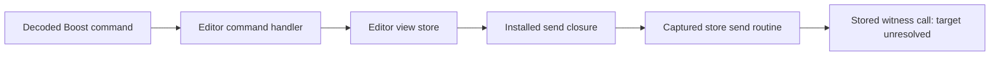

# Arc Boost store handoff and editor lifecycle

Date: **2026-11-08**, Europe/Berlin. Source parent:
`c748850e8ab2fe9b54e11d48bc08fd306d02b452`. This offline pass follows the
command-closure question from the [delegate/evaluator report](arc-dispatch-2026-11-06.md).
It establishes more of the store handoff and editor lifecycle; concrete command
effects and full Arc behavior remain incomplete.

The target is the same supplied **Arc 1.172.1 / build 90370 DMG**. Its ARM64
executable remains SHA-256
`6056139d78d9be98d2da8e64b2e7aab7c2946a130df392fa19af39a77963d578`.
Arc, its helpers and shipped scripts were not executed. No UI, profile, account,
service or target URL was accessed.

## Editor initialization and the dispatch object

Selected conformance metadata again finds the editor's four local conformances.
Its type reference is indirect: slot **`0x10422da70`** points to the nominal
descriptor **`0x103d7b65c`**. Five signed-relative method entries agree with five
stored pointers in the class metadata. The
[selector receipt](arc-command-effects-2026-11-08/selected-editor-methods.json)
retains these calculations and source Evidence IDs. These calculations prepare
caller seeds; they are not claimed as automatic REA+ method discovery or runtime
class instantiation.

The allocating entry **`0x1012d2e2c`** calls `_objc_allocWithZone`, then the
initializer **`0x1012d2e5c`**. The initializer clears its content/browser caches,
creates a view-store object from its incoming store through **`0x1008c7378`**,
stores the result, builds SwiftUI state/observed-object storage and installs
the subscription path at **`0x1012d3300`**.

The field previously described as the editor's “dispatch object” is more
precisely its **`_viewStore`**. The initializer stores the constructor's result
through **`0x104628310`**, the same offset word used by the prior command handler.
Public loaded bytes retain these offsets:

| Property observed in the native listing | Offset in the editor object |
| --- | ---: |
| `_viewStore` | `0x08` |
| `_contentView` | `0x10` |
| `_subscriptions` | `0x18` |
| `_boostIDEBrowser` | `0x20` |
| `_webContent` | `0x30` |

Initializer Evidence:
`ev_0980bc31a048d589a74c9fb01d961a0e6e67745a7b9703e84930b7569f32e947`.
Offset Evidence:
`ev_6e263fb7ec475f9d4bbf40a3da0682eec06800b646a329ec56fbac59669941a0`.

The initializer supplies **`0x1012d3200`** to the constructor. That function
copies selected state fields; it is a state projection, not evidence of a
command transformation. An earlier working interpretation called it an action
adapter; the [correction ledger](arc-command-effects-2026-11-08/analyst-corrections.json)
discards that interpretation.

## The installed send closure

The constructor path **`0x1008c7378` → `0x1008c784c`** allocates closure context
containing the incoming store at context **`+0x18`**. It installs code pointer
**`0x1008ca400`** and its context together at view-store **`+0x28`**. This is the
slot used by the already recovered command handoff at **`0x1008492c0`**.

The installed entry branches to **`0x1008c7c34`**, constructs an absent optional
value and forwards the payload to **`0x10088d940`** using the captured store.
There is now a concrete shipped-code route beyond the previous unnamed closure:

Installation Evidence:
`ev_55bf5aff084421bdc77ae72341e1778784ae90e348da893c74e49a397d7f53ac`.
Closure Evidence:
`ev_2aa6ddaa55a5760badcaf995511ccd3e47bb9181449ba55dcf6697392afb4107`.

The send routine retains an action array append, a processing guard and a loop
that invokes stored witness **`+0x20`** at **`0x10088de88`**. Machine instructions
load its type and witness from store **`+0x58` / `+0x60`**. The full observed
body has **806 instructions / 3,224 bytes**. This establishes the generic send
machinery, not which concrete reducer is installed or its application effects.

`resolve_native_call_targets` explicitly reports this call as **unresolved**.
A separate `trace_native_values` request also retains that unresolved edge.
Its bounded graph has **3,002 nodes / 3,112 edges**, with a requested first page
of **200 nodes** and depth **0**. Provider high-pcode is truncated, with **42
known omitted edges** and a lower bound of **1** omitted operation; those counts
are not repaired by treating the instruction listing as complete value flow.
The explicit trace depth also leaves direct callees outside this trace. These
are separate limits, not proof that all remaining effects require runtime work.

Send-loop Evidence:
`ev_79d12955203a62a5160c50e0b113b9ce1b4e76b82a649bc7421d44581e072ea0`.
Unresolved-call Evidence:
`ev_c6b75c2cb683e2337613a8f44f77cd57b277f70e28b13512ef31845c8d38bc93`.
Value-trace Evidence:
`ev_87ccd26a84fbcda9f3322351fe7d414713f7106183628ee80a57feb0c22c3ebb`.

## Editor URLs and cache release

The URL builder **`0x1012d3b04`** obtains an identifier and mode through view-store
keypaths. An absent identifier or raw mode **2/3** yields an absent URL. Mode
**1** chooses **`arc://boost/v2/js/`**; the other admitted branch chooses
**`arc://boost/v2/css/`**. It appends the identifier and calls Foundation's URL
initializer. The exact prefixes are corroborated by public loaded bytes. Their
route handlers, content persistence and successful URL construction for every
possible identifier are not established here.

The browser getter **`0x1012d3d8c`** reuses its cached object/witness pair. The
creation path first asks its manager for a browser; when that returns no object,
it invokes another manager entry with the shipped **`boost-editor`** string.
The manager's dynamic implementations remain unobserved.

Subscription entry **`0x1012d4dc0`** reaches shared code **`0x1012d3478`**. With a
live weak editor and a non-null native object, raw mode **2/3** triggers a manager
call through **`+0x320`**, then zeros and releases both cached browser and web
content pairs. This is a conditional static cleanup route, not an observed
window closing or a recovered source enum name.

Separately, the view-store constructor builds Combine **map**, **removeDuplicates**
and **sink** stages. Sink **`0x1008ca458` → `0x1008c7ce8`** checks weak captures,
emits `ObservableObjectPublisher.send`, and forwards the value to a state-holder
helper. The notification path is distinct from the command-send closure.

URL-builder Evidence:
`ev_1bf1ca191ba1fec69eae08447a60d72e82db090db7a1d51cc3ecd0578b0a4e4d`.
Cache-release Evidence:
`ev_22fa68f70f50604d0880bc4ebc09e8b1bc0caa1afd716283526f972d6dc928b3`.

## Verification, issues and next questions

- **77 public MCP calls / 73 successes / 4 errors** across eight sessions. The
  four errors are exact-address requests for methods absent from the initial
  partial Program. New bindings with explicit caller seeds recovered them;
  the original errors are retained. No unchanged retry is counted as recovery.
- For successful replies, the existing SDK recorder validates advertised schemas,
  named contracts and equal text/structured output. The
  [capture audit](arc-command-effects-2026-11-08/evidence-audit.json) authenticates
  **48 standalone Evidence records / 9 bundles**, without failures.
- [Nineteen finding checks](arc-command-effects-2026-11-08/findings-verification.json)
  pass. All eight sessions close with verified empty owned descendants. These
  are research assertions over real tool output, not new implementation tests.
- Every native binding uses an explicit **one-second** auto-analysis policy and
  reports a stable partial Program. Caller seeds and supplemental selector
  calculations remain explicit; empty partial-Program searches establish no
  global absence.
- [Input integrity](arc-command-effects-2026-11-08/target-integrity.json) rechecks
  the DMG, original executable, derived slice and all **1,113 regular extracted
  files / 916,318,369 bytes**. No implementation source changed in this pass.
- The [pre-push fast check](arc-command-effects-2026-11-08/pre-push-check-fast.log)
  passes typecheck and lint, both from the existing Turbo cache. No new full
  `check:pr` or implementation test run is claimed.

No additional REA+ product defect is established. The reference-only target
resolver, bounded high-pcode and caller-selected trace depth are recorded as
limits. A future dispatch improvement needs an owned fixture that distinguishes
statically provable witness identity from unknown store-instance state.

The next native question is where the incoming store's concrete reducer and
witness are installed, then how each command changes CSS/JavaScript and durable
Boost state. The internal URL route handlers are another independently
traceable entry. Bootstrap/injection, final overlay coordinates/rendering,
extension loading/name substitution and other Arc subsystems also remain open.
