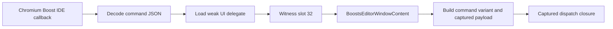
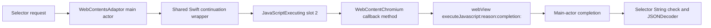

# Arc Boost delegate and selector evaluator

Started **2026-11-06**, continued **2026-11-08**, Europe/Berlin. Source parent:
`157268715f13ce1a01c9debe01043205d7c00b7a`. This pass follows the two priority
questions from the [DMG retest](arc-retest-2026-11-06.md): the concrete Boost
command delegate and the native JavaScript evaluator.

The target remains the supplied **Arc 1.172.1 / build 90370 DMG** and its
derived ARM64 main executable, SHA-256
`6056139d78d9be98d2da8e64b2e7aab7c2946a130df392fa19af39a77963d578`.
The DMG/extracted-app identities are retained in the parent report. No Arc,
helper or shipped script was executed. No UI, profile, account or service was
accessed. The small owned Swift witness fixture was compiled and analyzed,
never run. Binaries and provider projects remain outside Git.

## Boost delegate: resolved static assignment and dispatch

Public selected-conformance metadata identifies two local direct
`WebContentUIDelegate` conformances:

| Type | Conformance | Witness table | Command slot at table + `0x100` |
| --- | --- | --- | --- |
| `WebContentFrame` | `0x103744f38` | `0x1042d2e38` | `0x100006b90`, one `ret` instruction |
| `BoostsEditorWindowContent` | `0x10378a2a0` | `0x104318718` | `0x1012d2ddc`, a branch to `0x1012d2b84` |

The relevant command receiver is therefore no longer an unnamed protocol slot.
The editor's lazy `_webContent` creation path at **`0x1012d3c7c`** constructs
web content through its supplied factory, installs its own navigation/UI
delegate witnesses, and caches the object/witness pair. The existing-object
path returns the cached pair. The factory's runtime choice is not observed.
The frame's separate initialization path at `0x100e47b8c` installs its frame
delegate witnesses. Its Boost-command slot does no work.

The concrete Chromium wrapper's UI setter **`0x10054aec8`** stores the witness
pointer at delegate storage + 8 and uses `_swift_unknownObjectWeakAssign` for
the object. The field offset is **24**, verified through public loaded bytes
and the Objective-C ivar record for `WebContentChromium`. Its getter is
`0x10054aebc`. Empty direct caller lists do not imply these accessors are unused:
the creation code invokes them through the `WebContent` witness table.

The command route is now:

The substantive handler **`0x1012d2b84`** handles four decoded variants,
obtains the optional `boostIDE` object through `WebContent` slot 85, reads the editor's
dispatch object at self + 8, constructs its payload, and invokes the closure
at that dispatch object's + `0x28` through helper `0x1008492c0`. The handler
and dispatch handoff are recovered; the closure's concrete implementation,
full CSS/JS effects and persistence are not established by this pass.

Selected Evidence:

- Editor conformance: `ev_466fb3cca4956ff6ea131d8bb9b286cc217d078b6448f90c5683729193ec8188`.
- Editor assignment: `ev_261a24be1c410f0978ceeae2c44be0f1226019177d64f99a1981974eec368c75`.
- UI setter: `ev_e8c55c9022532d6582e0705b2329871307d57942eead38e740496a7957caf519`.
- Handler body: `ev_9898d66fe10da11c1efe316b170a0dc1f9df328a01cf5ce246296da01cdde1b1`.
- Four-byte frame stub: `ev_1ac911a2ea8947311fdf05b4fe6be924249957bedfe403e3b41a8b979a1b833d`.

## Response serialization

The fresh response helper **`0x100576028`** encodes its value with Foundation
JSONEncoder, converts Data to String, and selects native
`sendResponse:jsonString:` or `sendErrorResponse:jsonString:` dispatch.
Original selector slots, stub bytes and exact C strings corroborate the names;
the initial analyst labels are not used to infer their roles. The explicit
error variant uses `sendErrorResponse:jsonString:`. The JSONEncoder failure
branch constructs a fallback value and calls `sendResponse:jsonString:`;
these distinct error paths must not be flattened into one claimed behavior.
Evidence: `ev_c202997afec27237f8e32b648e4c0b3afcde3c6aba94646fa69695b40c67f83b`.

## Selector adaptor and execution

The selector interface is now identified as
**`SelectorPickerWebContents`**, and selected public metadata identifies
**`WebContentsAdaptor`** as its local conforming type. The stored witness
template is at `0x10431acb8`. The public metadata operation preserves the
conformance but reports its runtime-instantiated witness slots as unsupported.
The template is used only to select shipped code candidates, not to assert a
particular instantiated runtime witness table.

Public bytes retain an async descriptor at **`0x10378c758`** whose entry is
**`0x1012fa578`**, and a scale getter at **`0x1012fa5e0`**. The async entry
retains a main-actor executor and switches to **`0x1012fa3a0`**. That continuation
loads the adaptor's web-content object/witness pair, handles the missing-object
case separately, and forwards into the shared execution path while preserving
its return continuation. The callsite supplies the shipped filename constant
`BoostsEditor/BoostsEditorOverlayView.swift` and integer 61. The shared executor
constructs a colon-separated file/line label; these are debug context, not a
recovered source file or an isolated-world identifier.

The scale getter returns **1.0** when its web-content object is absent. Otherwise
it obtains the web-content features object and invokes its virtual getter at
metadata + `0x558`, converting the Float result to Double. The existing selector
request applies the reciprocal scale to lookup coordinates. The precise final
overlay coordinate spaces and rendering remain separate questions.

The feature getter selected by that virtual slot is **`0x10057cc54`**. It reads
through Combine.Published and two keypath patterns. This establishes the stored
feature-value route; the precise property/coordinate-space interpretation is
not inferred solely from the slot number or nearby ivar names.

### The selector uses the callback API

The concrete selector execution route is:

The shared executor's callback closure **`0x100557f04`** reaches
**`0x100557874`**, which builds the file/line reason string and invokes
`JavaScriptExecuting` witness slot 2. For `WebContentChromium`, the slot is
**`0x10054eb6c`**, forwarding to **`0x100548344`**. That method checks execution
availability, obtains an `emitFreezingVote:` token, bridges the script and
reason Strings, creates its completion block, and calls the native web view's
**`executeJavascript:reason:completion:`**. The exact selector spelling is
corroborated by public stub, selector-slot and C-string bytes.

The block reaches **`0x1005484c8`**, which marshals completion work to the main
actor using the shipped `ADK/WebContentChromium.swift` callsite context. The
final callback **`0x10054fbf0`** forwards a zero result pair when its captured
status flag is zero, and the captured result pair otherwise. The shared
continuation eventually forwards those two result words at **`0x100557840`**.
These are static callback/continuation rules, not observed JavaScript execution.

The fixed-version selector return entry **`0x1012e6494`** selects the normal
conversion continuation **`0x1012e64f0`** or a direct return path at
`0x1012e6628`. The normal continuation checks presence, dynamically casts the
value to String, invokes conversion helper `0x1012e6634`, and calls Foundation
JSONDecoder with its supplied type/witness arguments. Missing/non-String
values reach an allocated-error path. This is now corroborated on **1.172.1**,
rather than transferred from the earlier 1.171.0 result.

Selected Evidence:

- Shared callback submission: `ev_f96496c4e67bf9cbefa45145e307e5dafe1c873110ed49879b0dff2687a8913c`.
- Chromium callback method: `ev_eefce4eeaa5fc029d4e5ee2b2bedcf0c18a33b7dfd42cd914a511ae38fbb89ad`.
- Native selector bytes: `ev_6e29c31b32ef776de36386e55285a0ff29c4047d3659ba0902b5aff719c60304`.
- Main-actor completion: `ev_089ef2b318126d8627b5beeb61d4e30117dc0ce809eb28e23cb32ff11774bc15`.
- Fixed-version String/JSON continuation: `ev_592c7ccaf252deac592d3e700b24571dbe0257f7c339311a651726527cf41011`.

### A separate async API uses DevTools

`WebContentChromium` also implements `JavaScriptExecuting` slot 3 through async
entry **`0x10054eb8c`**. This route obtains the web view's **`devTools`** object,
handles its absence with an allocated error, holds an `emitFreezingVote:` token
across the await, and reaches shared async code **`0x10051aed8`**. That code's
later task entries remain indirect in this pass. It is **not** substituted for
the selector's slot-2 callback route. Earlier commentary combined the two
paths; the final findings and retained analyst-correction ledger separate them.

The selector-library loader and its resource cache are recovered, but direct
caller searches for the loader and adaptor entry were empty in the selected
partial Program. The library's complete bootstrap/injection path therefore
remains open; emptiness is not a claim that the code is unused.

## Newly recorded REA+ gaps

**51 — Protocol-scoped conformance discovery.** The public operation selects a
facet or an already-known conformance address. It cannot discover conformance
addresses by protocol/type before spending its decode budget. The earlier
20,000-record overview retained 1,435 conformance rows and missed the needed
types. Supplemental preparation over the complete **22,066-entry** public
conformance index, including distinct indirect alias slots, selected indices
6,632 / 10,138 / 10,205. Exact public metadata then recovered the types above.
These selectors are analyst derivations; they are not claimed as automatic REA+
discovery or proof of global conformance absence.

**52 — Static runtime-instantiated witness templates.** Exact Arc metadata
preserves the adaptor conformance and template address but no dispatch slots.
An owned optimized Swift library reproduces the same boundary for
`OwnedAdaptor: OwnedSurface`: the row has a template address and zero slots.
Public CLI/MCP metadata agrees, and public loaded bytes retain the shipped
template. Future support must distinguish static template entries from actual
runtime instantiation, retaining conditional requirements, holes and async
descriptors. See [owned source and receipts](arc-dispatch-2026-11-06/owned/).

**53 — Disk-capacity diagnostics.** A 60-second evaluator binding failed with
`java.io.IOException: No space left on device`, while the public result gave
generic `execution_failure` and “Retry once” remediation. The failed run is
retained. A fresh **15-second** profile with the same known seeds recovered
the evaluator continuation without repeating the same analysis demand. The
failure should identify confirmed disk exhaustion and truthful remediation.

The shared recorder also encountered identical content-addressed JSON Schema
IDs across different tools. The schemas are equal; this was a recorder cache
error, not inconsistent advertised contracts. The new local recorder compiles
one validator per identity and rejects divergent definitions. It retains AJV,
named-contract and text/structured validation. Other retained boundaries are
unseeded procedures in partial Programs, a supported full-dossier MCP transport
limit for the widely referenced return stub, a caller's invalid deep-provider
selection, and a bounded radare2 timeout. These are not counted as additional
REA+ defects.

## Evidence boundaries and remaining work

Early native bindings use the existing 60-second partial-analysis policy.
The evaluator follow-up explicitly changes to 15 seconds after disk exhaustion.
The final small callback/return checks use one-second profiles with explicit
known entries; these are not whole-image auto-analysis or absence claims.
Every seed is a caller assertion from public metadata, exact call targets or
validated LC_FUNCTION_STARTS bytes. Source addresses are native to 1.172.1;
earlier-version addresses were not silently reused. Supplemental scripts only
prepare selectors; public bytes, metadata and function dossiers validate the
resulting facts. Incorrect analyst candidates are preserved and explicitly
discarded in `analyst-corrections.json`.

Four [CLI/MCP comparisons](arc-dispatch-2026-11-06/cli-mcp-comparison.json)
retain equal normalized metadata, subjects and parameters. Canonical Evidence
IDs differ because MCP preserves its upstream Ghidra profile while standalone
artifact CLI inspection has no upstream profile; these are not claimed as
exact full-Evidence equality.

The first recorder run with `caffeinate` has an unavailable process-lineage
snapshot because an auxiliary child did not carry its verifier token. Two
later initial close operations conservatively reported `cleanup_incomplete`
while a JVM's ownership token was unreadable. Client shutdown then recorded
verified empty descendants; read-only follow-up also confirmed the exact
reported process and runtime directory were absent. Those initial errors are
retained rather than rewritten as successful closes. Later final callback and
return sessions closed successfully with verified empty descendants.

No REA+ implementation source changed in this pass. The previous implementation
suite belongs to the parent commit; it is not counted as a new test run for
these research notes. Verification here uses actual public CLI/MCP contracts,
saved-result assertions, canonical Evidence/bundle authentication, an owned
compiler reproduction and renewed input-integrity checks.

Final verification on 2026-11-08:

- [Evidence audit](arc-dispatch-2026-11-06/evidence-audit.json): **135** standalone
  records authenticated, **31** bundles validated, no failures.
- [Finding checks](arc-dispatch-2026-11-06/findings-verification.json): **20**
  passed, including the actual callback selector and fixed-version JSON return.
- [Input integrity](arc-dispatch-2026-11-06/target-integrity.json): the DMG,
  original executable, ARM64 slice and all **1,113** extracted regular files
  still match their recorded commitments (**916,318,369 bytes** of extracted
  files).
- [Capture summary](arc-dispatch-2026-11-06/capture-summary.json): **12** shared
  recorder sessions, **192** recorded calls (**178** successes / **14** errors).
  One additional successful reply was saved before the recorder schema-cache
  failure; its [separate verification](arc-dispatch-2026-11-06/seeded/recovered-reply-verification.json)
  authenticates the Evidence, advertised schema, named contract and equal
  text/structured output. Separate CLI/compiler calls are outside those counts.
- [`npm run check:fast`](arc-dispatch-2026-11-06/pre-push-check-fast.log):
  typecheck and lint passed, both from the existing Turbo cache. No new
  implementation test suite was needed for this evidence/documentation batch.

The broader investigation still needs the command dispatch closure's effects,
full Boost state/persistence, final overlay rendering/coordinates, extension
loader/name substitution and unrelated Arc subsystems. Runtime activation and
concrete object instances remain unobserved. The recorded tool gaps 51–53 are
open at capture time; this analysis pass does not claim to repair them or complete
Arc recovery. **Subsequent 2026-11-08 update:** issue 51 is now fixed and retested
in the [conformance discovery report](arc-conformance-discovery-2026-11-08.md).
Item 52 is also subsequently fixed in the
[witness-template report](arc-witness-templates-2026-11-08.md). Item 53 is subsequently
repaired in the [disk-diagnostics report](arc-disk-diagnostics-2026-11-08.md).
