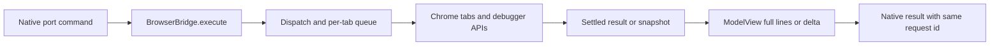

# HeyClicky browser and drawing feature follow-up — 2026-10-29

This pass advances the app investigation beyond tool verification. It follows
shipped source from extension startup through command dispatch, tab state,
page operations and model results, then maps the drawing adapter's native
interface. **The browser source paths are mapped; native integration and
runtime behavior remain partial.** No app, helper, extension, bundled runtime
or shipped source was executed, no service contacted and no user data read.

The target remains HeyClicky **1.1.1 (66)**. All eight reviewed source files
hash identically to the earlier before-analysis resource manifest. Exact
source SHA-256 values, ranges, findings and limits are retained in the
[receipt](heyclicky-browser-followup-2026-10-29.json).

## Extension startup and protocol

`manifest.json:1–45` declares a Manifest V3 module service worker,
`background.js`, extension version 0.6.3, Chrome minimum 120, popup and the
`debugger`, `tabs`, `nativeMessaging`, `storage`, `alarms`, `tabGroups` and
`downloads` permissions. No declarative content script is listed.

`background.js:1–58` registers the popup message listener before guarded
startup steps, constructs `BrowserBridge` and `ModelView`, and restores owned
tab state from session storage. `connect()` persists a per-profile UUID in
local storage, opens `com.heyclicky.browser`, and sends
`{type:'hello', protocol:1, profileId}`. Native `ready` messages set selected
profile/reachability state. Disconnect or deselection stops existing browser
work; startup/install events and a 0.5-minute alarm attempt reconnection
(`:192–204`).

The source-traced request path is:

The command branch calls `bridge.execute(message)`, applies `ModelView`, and
returns a result/error with the same ID (`background.js:39–55`). It does not
independently test the `connected` flag there; that flag drives status and
stop-on-deselection. Actual native-side profile selection and command admission
need corroboration. The earlier helper dossiers support four-byte length plus
JSON framing; this pass did not redo or extend those native dossiers.

## Job, turn and tab state

`core.mjs:108–245,255–359,569–671` separates two identities: a task/turn owns
cancellation and turn cleanup; its `owner`/thread owns tabs, groups and kept
pages across turns. `ownedTabs`, `homes` and `kept` arrays persist through
service-worker restarts. Debugger refs, queues and active task state are
in-memory.

A new tab opens unfocused beside the user's tab or an existing job group.
Groups use blue and a task title capped at 32 characters. A later turn reuses
its owner's group, including a group the user dragged to another window.
Without a usable normal window it creates an unfocused window. Acting in a
user tab claims it; read-only operations on a background tab leave it in place.
Claims record the old group/window/index and restore those if the user has
not moved the tab since.

Normal `end(tidy:true)` detaches debuggers, restores claims and closes unkept
job tabs. Frontmost tabs and tabs moved out of the job group become user-owned
instead. `keep` admits only `result` or `waiting` reasons. User Stop hands job
tabs to the user without closing them; disconnect/timeout stops access without
immediately replaying cleanup. `sweep` reconciles turns after app reconnection.
These distinctions are source-observed; no running browser state was read.

## Browser operations and feedback

Direct inert AST inspection finds **24 operation names** and **63
`BrowserBridge` methods**. The 24 names are:

`back`, `batch`, `click`, `click_at`, `close`, `dialog`, `download`, `drag_at`,
`end`, `extract`, `fill`, `hover_at`, `javascript`, `keep`, `open`, `press`,
`screenshot`, `scroll`, `snapshot`, `sweep`, `tabs`, `type`, `upload`, `wait_for`.

- **Dispatch and batching:** `core.mjs:494–561,676–721`. Commands require a
  nonempty task identity except `sweep`; internal deadline/batch fields are
  stripped. Page actions become one-step batches. Explicit batches validate
  1–20 steps before execution, serialize by tab, stop at the first failure,
  loading page or dialog, and attempt a final snapshot.
- **Access and references:** `:467–492,932–942,1030–1120`. URLs must be
  credential-free HTTP(S); private tabs and another running owner's tabs are
  refused. Debugger attach uses protocol 1.3. Each command rechecks task, URL
  and epoch. Accessibility nodes get `eN` references backed by DOM node IDs;
  navigation retires those refs. Snapshot admission is bounded to 600 nodes /
  640,000 serialized sample bytes, prioritizing controls and nearby content.
- **Model feedback:** `:63–105`. Nodes become short element lines. If an
  action leaves at least half the lines unchanged and the change set is small,
  the response contains added/removed lines or `unchanged`. Query and
  interactive subsets never overwrite the full-page baseline.
- **Input:** `:788–930,1349–1450`. Clicks resolve a current backend node,
  verify visible hit targets and report blocking overlays; optional dismissal
  tries Escape and one covering-layer control before retrying. Fill rejects
  password/OTP/payment autofill targets. Typed input checks focused password
  fields. Pixel click/hover/drag requires a screenshot from the same epoch.
  These local checks are not a global security policy: `javascript` separately
  accepts up to 20,000 characters of caller code for `Runtime.evaluate`.
- **Read/extract/wait:** `:1147–1186,1307–1321,1632–1704`. `wait_for` polls
  text/URL appearance or disappearance. Screenshots use CSS-sized JPEGs,
  subject to a transport cap. Extract walks main-frame content into bounded
  markdown-like text and CSV tables, skipping form values and iframe content.
  Extract does not create action references.
- **Files:** `:389–451,1231–1305`. Downloads receive sanitized task-scoped
  names and report completion, interruption, dangerous-file holds or later
  progress. Uploads validate 1–10 absolute paths, set file inputs or intercept
  the chooser, and settle afterward. The source comment that the app already
  checked file paths is not evidence of the native check.

The source includes conservative navigation/settling and cancellation checks.
They describe implemented branches, not proof that every external site or
Chrome state behaves as intended.

## Extension presentation and cursor design

`background.js:60–125` reduces connection and active tasks into toolbar
states: checking, setup, offline, another profile, connected and working.
`popup.js:142–253` polls status once per second, uses a 1.5-second response
limit and calls two consecutive misses stalled. It shows up to three job
cards with progress and tabs, preserves cards across refreshes, and supplies
Stop, open-app and worker-restart actions. Cursor visibility persists locally.

`popup.css:1–58` defines a **280px** popup, black background, compact status,
stacked live cards and reduced-motion alternatives. `ui.css:4–99` supplies
black/light text tokens, paper/ink cards, aqua gradient gel buttons and a
32×18px switch. Comments link those tokens to named native components, but
source comments do not establish visual identity with a running native app.

`core.mjs:1188–1229,1480–1601` implements the in-page presence. A best-effort
main-frame isolated world injects a zero-size, fixed, closed-shadow,
`aria-hidden` host with `pointer-events:none`, top stacking order, an edge
glow, **16px triangle tilted −35°**, and a grey **11px** progress bubble.
Movement uses a 240ms default glide; words stream by punctuation timing.
Reduced-motion or hidden pages show text immediately. Screenshot calls hide
presence temporarily and restore it afterward. Isolated-world creation has a
fallback without a context ID, so isolation cannot be asserted unconditionally.
This is the browser overlay; it does not establish the native notch layout.

## Drawing: concrete native interface

`clicky-draw-native.js` implements a small DOM used by the SVG-producing
`ClickyDraw` engine. Element mutations accumulate dirty units, removals,
structural wraps and property/motion patches (`:124–239,289–339`).
`__drainRender()` returns ordered JSON operations: remove, wrap/set, then
property and motion updates. Serialized nodes carry IDs, tags, attributes,
children/text, style and animation information. `HOST` supplies time,
scheduling, text/path measurement and logging. The code's ownership flags say
the host draws pointers, buttons, windows and marquee (`:380–406`).

The adapter exports **22 `clickyCanvas` methods** and references **17 host
members**; the receipt records each exact AST range. Its feature paths include:

- `beginStream` → `ClickyDraw.live` with external speech timing; `feed` updates
  the program and analyzes complete statements (`:637–693`).
- `line`/`lineLength` → engine line start/end times, subtitle updates and
  button-release logic (`:695–737`). Buttons wait for their beat's drawing and
  call `HOST.buttonReady`; sound classifications call `HOST.markSound`
  (`:422–515`).
- `continueStream` retains the existing card for another turn; `state` returns
  text describing drawn content. `keepNotesOnly` and `dropPointing` remove
  screen-dependent pointers while retaining cards (`:655–680,742–752`).
- `cards`, `closeCard`, `zoomCard`, `moveCard`, `buttonSpot` and `markBox`
  expose card geometry and manipulation (`:755–827`). Button placement tries
  collision-free positions around measured text.
- `tick3d` emits **14 Float32 values per part**, with flags for position,
  rotation, scale, shown, glow and color. Throwing ticks stop; ticks taking
  more than 8ms stop after more than five slow observations. `renderWhole`
  renders a full program outside speech streaming (`:835–879`).

The header describes JavaScriptCore, Core Animation and Core Text; comments
name `ScreenDrawingNativePainter`, `ScreenDrawingActionButtons`,
`ScreenDrawingCardDragHandles` and `ScreenDrawingSoundPlayer`. Their actual
construction/call sites and consumption of these records are **not yet
corroborated here**. The comment that this context has no network/files is an
intended constraint, not a verified native isolation boundary. Detailed engine
geometry, piece semantics and native Metal rendering are also not finished by
mapping this adapter.

## REA+ evidence, completion and remaining questions

A fresh public `inspect-analysis-view` call selected the exact retained
`core.mjs` source-module node and returned all eight exports, with no export
omissions. It exited 0 in **3,248ms**. View Evidence:
`ev_ddb91055f729947e83a475507854f1887739eed85d3582fce87280ca8a950c75`;
parent `ev_d1105abe4988de128b79b1441f5f31174bce5aad4a3cd85f50bdbee1f871a5e0`.
The item view is complete within its selector; its parent still reports
**4,600 semantic unknowns**. Full-resource graph caps do not prevent reading
available shipped source. The known receiver-fact collision (item 36) is not
used as authority for the behavioral conclusions above.

| Question | State after this pass | What remains |
| --- | --- | --- |
| Extension startup, operations, tab ownership and model feedback | Answered from shipped source | Runtime corroboration of actual Chrome behavior |
| Native messaging boundary | Partial | Native helper-to-app routing, selection/admission and caller schema |
| Popup and browser presence design | Answered from shipped source | Actual rendering and interaction, native visual parity |
| Drawing adapter and exported interfaces | Answered from shipped source | Native JS-context construction, host/paint consumption and isolation |
| Drawing/3D algorithms and voice integration | Partial | Engine/piece geometry, native renderer and speech-timestamp producer |

No additional REA+ product defect is demonstrated by this source pass. The
native and engine follow-ups above are unperformed investigation, not claims
that suitable tools are absent. Existing public native call/reference/value
workflows can be tried against the recorded seeds. Runtime confirmation still
falls outside this offline pass; no app execution was inferred or performed.

Raw view, invocation receipt and direct inert AST inspection are under
`/private/tmp/rea-heyclicky-browser-followup-2026-10-29-q_zemiyl/`. No broad
analysis was repeated, and no production source, OPEN_TASKS entry, commit or
push was changed by this subtask.
