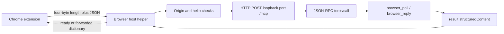

# HeyClicky browser native-host routing — 2026-10-29

This follows the helper beyond the earlier read/write framing dossiers. The
static code connects extension messages to **loopback HTTP JSON-RPC**, rather
than leaving the helper-to-app transport unknown. No app/helper/runtime was
executed, no service contacted, and no installed user data or credential file
was read.

## Identified input and public verification

The original `Contents/Helpers/ClickyBrowserHost` is 207,728 bytes, SHA-256
`5fb7e18d994bbdcb9d1d380e492fc8cf38e28efd58dea0b470db48027714965c`.
A fresh exact arm64 slice at parent offset 98,304 is 109,424 bytes, SHA-256
`57df5ec91fd804279fda1d46a6cd577375bf006396a3a7b4f49bd22a3d6cb179`.
Both hashes match the baseline and the final recheck.

The recovery pass completed **14 actual public MCP calls**, all with advertised
input/output and canonical success-schema validation. The fresh overview took
**30,360ms**, yielding **318 procedures / 632 defined strings / 32 blocks**.
The explicit 60-second profile measured `analysis_complete:true` and
`analysis_timed_out:false`. That records completion of Ghidra auto-analysis,
not complete semantic recovery of the app. Overview Evidence:
`ev_7206aef79531c6e596f5170a120bcbd9ec2caad31b0d6ba2d47c014cfdeee075`.

## Extension → helper → app transport



Entry `0x100000e30` reads an extension-ID list from the shipped
`Resources/ClickyBrowserExtensionID.txt` path, trims nonempty lines, constructs
`chrome-extension://<id>/` values, and compares the invocation origin before
accepting messages. It obtains standard input and initializes an output lock
and a process session UUID. No live browser identity was inspected.

The selected arm64 implementation reads a four-byte length and guards the
payload to **1..1,048,576 bytes** before reading/parsing its JSON dictionary.
Output `writeMessage` serializes JSON and writes its four-byte length and
payload under the output lock. Instructions corroborate the little-endian
header representation for this architecture.

The first message must be `hello`, with protocol integer **1**. Profile parsing
and UUID-related checks precede setting the started flag and scheduling the
poll loop. Invalid packet/type/initialization paths exit instead of dispatching
arbitrary operations. Swift UUID/type warnings remain; no extra identity policy
is inferred from unreliable temporary-variable casts.

Request function `0x100002b7c` constructs its configuration path beneath
`Library/Application Support/Clicky/BrowserBridge` and appends
`connection.json`. Its code checks an integer port in **1..65,535** and a
string `token`. The installed file and token value were not read.

The request path constructs:

```text
POST http://127.0.0.1:<port>/mcp
Authorization: Bearer <configured token>
Content-Type: application/json

JSON-RPC 2.0, generated request id, method tools/call
params: name <browser tool>, arguments <payload plus session/profile>
```

The `token` literal is reconstructed by public instructions at
`0x100002ed4..0x100002edc`; `POST` is reconstructed at
`0x1000030c4..0x1000030d4`. Public byte reads corroborate the loopback prefix,
JSON MIME type and `structuredContent` key. The request code uses a 30-second
URLRequest timeout, an ephemeral URL session, an empty proxy dictionary,
completion callback/semaphore and JSON parsing. It extracts the response's
`result.structuredContent` dictionary. This is static implementation evidence,
not an actual HTTP exchange or proof of the main server's authorization policy.

## Polling, replies and presentation control

The background closure at `0x10000281c` repeatedly calls `browser_poll`.
A missing result produces `ready`, `selected:false`, `app:false`, then a
two-second sleep. A result produces `ready` with selected status and `app:true`,
and may forward an optional dictionary to the extension. The decompiler leaves
that dictionary lookup's key unnamed; this report does not invent it.

Subsequent extension `result` or `stop` packets call `browser_reply` through
the same JSON-RPC request wrapper. This joins the earlier extension
command/result path to the actual helper transport. Native main-app admission,
profile selection and queue handling still require its server handlers.

An `openApp` packet calls `openHeyClicky` (`0x100003cbc`), whose code resolves
its bundle location and constructs an NSTask-based opening route with
`heyclicky://settings/browser`. That branch was decompiled and its instructions
read; the task was never run.

Principal Evidence:

- Entry: `ev_e434b94cd01bce1ee76a453dd8a74e40d3f848a5c6d19e29a52e229a6fba8d46`.
- HTTP request: `ev_fad0c91241bd10c39c3c4a84b9431c18e376c6f5d488f4a649bca4afcd792e58`.
- Request instructions: `ev_82fbc5aeba64efcd5bf3f5b295f35c2774208df787510ffd8501a4b2271e585b`.
- Poll loop: `ev_678f875e3b23424ff0138366114e020c1d4d535b86da7f50a67c382657919a16`.
- Literal bytes: `ev_aec583f9ddb86997bab105c7f83f32ec4f8f7f2f9754e5b3dcce1e0c4c5bc01b`.

## Storage interruption, cleanup and remaining scope

The first attempt hit **ENOSPC while persisting its overview reply**. That
reply was not retained, so its analysis outcome is unverified. The queued
entry/search calls were not executed. Its later public close and unchanged
hash receipt are retained separately; the long wall-clock session included
idle waiting and is not an import-time measurement.

After space recovery, the fresh pass above succeeded, public close completed
in 585ms and the temporary driver exited 0. The generic final verifier lineage
was **unavailable** due a descendant token mismatch. A later scoped host check
found all eight recorded old/new verifier/helper/provider/decompiler PIDs
absent. This establishes those known PIDs exited, without rewriting the
unavailable lineage snapshot as a verified empty descendant set.

The [receipt](heyclicky-browser-host-followup-2026-10-29.json) retains exact
commands, profiles, hashes, literals and failure/cleanup scope. Raw records
remain at `/private/tmp/rea-heyclicky-host-followup-2026-10-29-c6pv0v95/`.
The helper's origin/framing/request/poll/reply paths are answered from code.
Main-app server admission/routing and actual extension/app behavior remain
separate questions. No production code, commit or push was changed here.
