# HeyClicky drawing engine and pieces — 2026-10-29

This extends the [browser/adapter follow-up](heyclicky-browser-followup-2026-10-29.md)
through actual program execution paths, geometry, layout and timing in the
shipped engine. It is source analysis: **no shipped JavaScript, app, helper or
bundled runtime was executed**, no service contacted and no user data read.
The previous follow-up and its hashes remain unchanged.

The engine declares version **1.6**. `clicky-draw-engine.js` is 256,034 bytes,
SHA-256 `f2161b9c4def6092f5f866d5135ef3fea23a25e01787c22844b0002cebd8b966`;
`clicky-draw-pieces.js` is 65,245 bytes, SHA-256
`13872a70cddfb18368a1f3f789be76dca127608b91eea1928e24fb145cae96b8`.
Those and the adapter/3D-helper hashes still match the earlier resource
manifest. The [receipt](heyclicky-drawing-engine-followup-2026-10-29.json)
retains exact source ranges and the existing REA module identities.

## Program → marks → layout → pacing → paint

```mermaid
flowchart LR
  P[JavaScript program plus pieces] --> B[Statement boundary scanner]
  B --> R[Persistent Session or whole-program fallback]
  R --> M[Plain geometry and action marks plus say lines]
  M --> L[Layout and natural duration]
  L --> T[Pacer with supplied speech times]
  T --> S[SVG-like surface painter]
  S --> A[Adapter DOM mutations and motion callbacks]
  A --> Q[__drainRender JSON operations]
  Q --> N[Native consumption still to corroborate]
```

The program is JavaScript using drawing helpers, rather than a separately
parsed declarative language. `makeRunner.statementEnds` skips comments and
quoted strings and tracks bracket depth to find likely statement endings.
`statementScanner` caches an append-only prefix and rechecks its last boundary
(`clicky-draw-engine.js:187–227`). This scanner is a boundary heuristic; the
actual Function/eval compiler parses the code.

`transform` rewrites top-level `const`/`let` to `var`, keeps helper declarations
that shadow API names, and can attach names to figure parts (`:1020–1046`).
`Session` maintains a generator scope that evaluates each new complete tail
once. A non-append update resets it. An unfinished syntax error waits for more
input; another error switches to full-prefix replay. `runCode` compiles a
whole program with `Function('api', 'with(api){…}')`, recovers the longest
parsable statement prefix and preserves already-produced marks after an error
(`:1048–1119`). These are the app's implemented execution branches; this
analysis did not invoke them.

`makeApi` builds primitive calls such as `line`, `curve`, `circle`, `ellipse`,
`rect`, `poly`, `path`, `text`, `arrow`, `highlight`, `dot`, `image`, `__window`
and `molecule`. Calls append plain objects with a `do` tag, geometry/options,
step/turn identity and narration ownership. `say()` records its line at the
current mark index (`:258–302`). The pieces are prepended in that API scope.

An important design detail is that some marks carry actions instead of ink.
`typeText`, `copyText`, `openPage`, `handOff` and `button` emit transparent tiny
dots with roles and payloads (`clicky-draw-pieces.js:454–506`). The adapter's
`analyseNow` collects those roles into action records and excludes invisible
host spots from its count of visible ink (`clicky-draw-native.js:579–621`).
The native action consumer and its admission checks remain untraced.

## How the drawn look is generated

The geometry pipeline is explicit in source:

- A seeded linear-congruential generator makes wobble repeatable; render seeds
  also depend on mark ID/index (`engine:74–75,1982`).
- `densify` samples line segments. `catmull` makes Catmull–Rom curves.
  `handSegments` adds perpendicular sinusoidal bow/jitter, while `ellipsePts`
  adds low-frequency perturbation and a small overshoot (`:80–139`).
- `outline` offsets centerline points to make a tapered filled stroke. With
  taper 0, `evenOutline` instead constructs an even-width outline with round
  caps (`:141–175`).
- `surfaceFor.stroke` creates that filled path and a separate white mask path
  with `pathLength:1` and dash animation. Revealing the mask gives the pen
  effect. Glow/halo metadata and watercolor filters are separate from the
  stroke geometry (`:1676–1750`).
- `paint` selects the path for each `do` kind: hand lines/arrows, sampled paths,
  wobbled circles/ellipses and the remaining mark families (`:1963–2172`).
  Native marquee frames use explicit `data-marquee` attributes instead of
  ordinary dash-by-dash rendering (`:1999–2009`).

The default handwriting face is Patrick Hand; UI labels use the system font,
serif material uses Georgia/Times, and the card-type flag selects Barlow for
non-UI card text (`:27–71`). These are source-defined choices. Exact native
font measurement/rasterization still depends on the host functions.

## Placement is layered and heuristic

Piece-level label placement tries positions above/below/beside the marked box,
rejects overlap with prior labels/marks, then scores the remaining positions
using native-provided busy-area cost plus order/distance preferences
(`pieces:135–175`). This explains why a name can move away from a busy part of
the screenshot even before paint.

`Layout` separately models containers, approximate text boxes, line points
and occupied areas. Shape intersections are sampled on a **14×14** grid.
Unintended partial overlap between comparable labelled containers triggers a
nearest valid candidate offset within roughly **22% of the shorter canvas
dimension**; when none is found, the engine records an overlap warning. Edits
can forget erased indices or reset layout (`engine:1264–1405`).

The painter then uses measured `getBBox` results to place words relative to
existing text and shapes (`:1753–1769` and its following placement logic).
The adapter supplies native text/path measurements. These layers improve
layout but do not guarantee that every generated program has no overlaps.

## The speech and pen timing model

`Stream` joins runner output, layout and pacing. It ingests marks and say
lines, assigns each mark to its narration line and computes a natural
duration. In sequential mode, outlined strokes advance at least their duration
plus 0.03 seconds (`engine:1490–1585`).

`natural` estimates time from path length, text length or mark type. Pen
duration is `clamp(base + length/per, min, max)`; `together:true` gives zero
advance so layered fills start together (`:1186–1234`). The native adapter
sets `per:1400`, `base:0.25`, `min:0.3`, `max:1.4` and separate screen pacing,
so the engine's default values are not the selected native values
(`adapter:347–360`).

`Pacer` fits the following strokes into each line's spoken interval:

1. Start after the later of the drawing cursor and speech start plus lead.
2. Reserve the tail at the line's end, then divide available time by the sum
   of stroke advances and the final stroke's duration.
3. Bound stroke pace and gap spread, including a faster rush floor when a
   line is crowded or late.
4. Release due marks through `onDraw`; marks without an available narration
   start remain waiting (`engine:1408–1487,1598–1629`).

The adapter selects `speech:'external'` and calls line start/end from
`clickyCanvas.line`/`lineLength` (`adapter:637–715`). Its selected pacing is
minimum 0.8, maximum slow 1.4, maximum spread 1.25 and rush 0.1. This recovers
the scheduling model; it does not yet identify the native speech-timestamp
producer or prove actual audio/visual synchronization.

## Concrete pieces and editor behavior

| Piece/path | Recovered behavior | Source |
| --- | --- | --- |
| `ring` | Expand a target by four screen points; choose pill/small-round/bounded rounded-box corners; draw a bowed even-width line plus a placed label. | `pieces:218–236`, point conversion `:41–54` |
| `frame` | Emit faint tint plus dashed outline; optional marquee metadata lets a native host animate its opening. | `pieces:207–216` |
| `target` / `hover` | Emit an invisible role-mark when the host draws pointers; otherwise draw a JS fallback outline and label. | `pieces:188–201` |
| `paper` / `__win` | Emit a native window mark when host-window ownership is set; otherwise construct sheet, header and controls as SVG-like marks. Add heading/subtitle and return remaining content bounds. | `pieces:746–841` |
| `button` | Encode text/kind/value in an invisible role-mark; action kinds include open/copy/ask/handoff/card. Pick a clear nearby box; draw a fallback gel button only without host-button ownership. | `pieces:470–502` |
| `figure` parts | Normalize shape recipes and pose/material/parent identity, expand copy/around/mirror placements, emit `part3d`, and optionally start native shape creation early. | `engine:580–617,702–772` |

The editor maps source statements to marks, supports part IDs plus `mN` and
mark ranges, and keeps per-mark DOM nodes/masks for later edits. Erase walks
marks in reverse paint order. Repaint, move/scale and removal preserve their
mark associations (`engine:2703–2792`). A program edit is planned into layout
and pacing, then applied at its scheduled mark time (`:2950–2972`).

Where the adapter's `__clickyMotion` hook exists, the engine declares one
property transition with start/duration/easing and lets the host animate it;
it uses per-frame JavaScript changes otherwise. The adapter turns those
callbacks into motion operations, and synthetic DOM mutations become ordered
`__drainRender` updates (`engine:2265–2349`, `adapter:289–339`). This closes
the source-level engine-to-adapter path. It does not establish the native
operation consumer.

## 3D and execution limits

The painter emits custom `scene3d`, `part3d`, `label3d`, `tick3d`, motion and
camera tags carrying typed JSON/data attributes (`engine:2144–2168`). The
adapter's `tick3d` packs pose changes for native consumption. That recovers
how scene information crosses the JS boundary; native meshes, materials,
shaders and the exhaustive 3D helper/library algorithms remain unfinished.
`clicky-three-parts.js` was identity-checked and parsed inertly, not exhaustively
traced in this pass.

The runner limits marks to **2,000** and sink warnings to **40**; its
cooperative deadline check runs when a mark is pushed (`engine:187–190,258–269`).
The optional Worker runner defaults to **1,500ms** outer termination and sends
an 80% cooperative budget. `Stream` chooses it only when
`sandbox:'worker'` is requested and Worker exists; otherwise it constructs a
synchronous Session (`:1125–1183,1607–1611`). The native adapter's visible
`live()` options omit that sandbox choice (`adapter:637–652`). Thus these JS
checks alone do not establish preemption of a non-emitting loop. Any native
JavaScriptCore execution limit and isolation policy still need native code
evidence; this is not a demonstrated sandbox vulnerability.

## Evidence and completion

The existing full REA Evidence
`ev_f006528bb14010cea6d5143aaf3a4b61451e491605b7394eba6d9c54076937dc`
retains the engine, pieces and adapter source-module identities. Their hashes
match the current installed source. A direct Babel AST parse of engine,
pieces and 3D helper produced zero parse errors and 47 selected callable
landmarks, without executing code. Raw receipt/outline data is under
`/private/tmp/rea-heyclicky-browser-followup-2026-10-29-q_zemiyl/`.

The program → marks → layout → pacing → painter → adapter path and concrete
piece behaviors above are **answered from source**. Still open are native
JS-context construction, host/action/paint consumers, actual speech timing,
native rendering and authorized runtime corroboration. No new REA+ tool
failure is demonstrated by this pass; full graph caps did not block reading
and tracing available source. This follow-up does not claim complete app or
3D-algorithm recovery.
