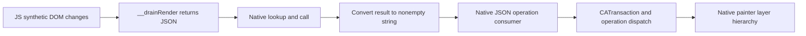

# HeyClicky drawing JS/native boundary — 2026-10-29

The main executable now corroborates the JS-to-native render path. A native
routine looks up **`__drainRender`**, invokes it, converts its result to a
string and passes nonempty output to a native JSON-operation consumer. That
consumer dispatches matching operations inside a Core Animation transaction.
The painter constructor builds the same four named groups as the JS engine.
These are code facts beyond resource co-presence or comments.

This extends the [engine/pieces analysis](heyclicky-drawing-engine-followup-2026-10-29.md).
The [receipt](heyclicky-drawing-native-followup-2026-10-29.json) preserves exact
public replies, hashes, metadata, derivations and limitations. The target is
unchanged HeyClicky **1.1.1 (66)**, arm64 SHA-256
`bb98afe140170240037589647cbfe00099079655e9223ec87f7f702db3fb7911`.
During the static stages reported here, no app, helper, extension, bundled
runtime or shipped source was executed; no service was contacted and no user
data read. Requests used the native
worker's existing public MCP driver; this worker launched no separate analyzer.

## Recovered render path

The public dossier at **`0x10178a3b4`** spans **992 body bytes**. Its
instruction/call facts show:

| Site | Observation |
| --- | --- |
| `0x10178a400` | Load field `+0x20`, matching the declared engine `context` field. |
| `0x10178a444–0x10178a45c` | Construct a string from `0x102ee5119`, length 13. |
| `0x10178a484` | Call the decoded `objectForKeyedSubscript:` stub with that key. |
| `0x10178a4d8–0x10178a518` | Build an empty argument array and call `callWithArguments:`. |
| `0x10178a560` | Call `toString`, then bridge to Swift string. |
| `0x10178a668–0x10178a66c` | Check `String.isEmpty` and skip processing when empty. |
| `0x10178a678–0x10178a690` | Load field `+0x10`, matching `painter`, and call `0x101798320` with the string. |
| `0x10178a6a0–0x10178a6f8` | Check/invoke optional callback `+0x68`, matching `onRenderOps`, with the same string. |

The public byte read returns all **13 bytes** at `0x102ee5119`:
`5f5f647261696e52656e646572`, exactly **`__drainRender`**. That joins the
lookup to the export at `clicky-draw-native.js:302–328`.

Dossier Evidence:
`ev_7df982a43ef2e55b885bc13c39e762d7718764633639dee8dbb616898b13ee97`.
Literal Evidence:
`ev_a3c519d405df238cf1c64eb23293c98a66b246b3a4a59b62b99ce7c40c32f86f`.

The method remains unnamed. Receiver/class correlation uses metadata offsets
and surrounding constructor/call relationships; it is a derivation, not a
fully recovered Swift signature. Instruction sites and literal bytes are
independently retained.

## Native JSON operation processing

The public dossier at **`0x101798320`** spans **10,668 body bytes** and has
**47,391 pseudocode characters**. It converts the string to UTF-8/Data,
calls `NSJSONSerialization.JSONObjectWithData:options:error:`, bridges/casts
the result and iterates operation dictionaries. It reads `op` and compares
**remove, wrap, prop, stop, motion and set**.

The operation pass calls **`CATransaction.begin`**, **`setDisableActions:true`**
and **`commit`**. Selector identities come from already provider-read
Objective-C selector/stub pages, not guessed names for anonymous helpers.

| Operation | Helper reached in decompiled dispatch |
| --- | --- |
| `remove` | `0x10179d830`, after reading `n` |
| `wrap` | `0x10179e720` |
| `prop` | `0x10179f3e0` |
| `stop` | `0x1017a06fc` |
| `motion` | `0x1017a0ca4` |
| `set` | Definitions route `0x1017a3228`; node construction route `0x1017a3d9c` |

This mapping comes from literal comparisons and decompiled branches. Detailed
helper semantics remain unexamined; matching an operation does not establish
all validation/animation rules. Swift ABI and dead-code warnings remain in
the raw dossier.

Some literals appear as `UNK_…` despite explicit pointer/count operands.
Reading their exact hash-identified Mach-O spans recovers `remove`, `prop`,
`stop`, `motion`, `set`, `defs`, `k` and `n`. Those are separately recorded
derived annotations; no provider database was edited. The drain literal also
has the public byte-read corroboration above.

The adapter emits the same family. Its `stop` clears an animation; property
updates include opacity, mask dash offset and transform
(`clicky-draw-native.js:75–116,142–146`). This closes the visible
producer/consumer operation contract while keeping downstream rendering
details separate.

Consumer Evidence:
`ev_3090f2afab95c956e7580ad1b540d24714a37f1f024f22cedf2ca3b6baa01678`.

## Engine and painter construction

Swift metadata supplies `ScreenDrawingNativeEngine` vtable slot 24 at
**`0x10177dec8`**. Its recovered factory allocates a **168-byte** object and
calls **`0x10177fdb8`**. That constructor calls painter factory
**`0x1017971e0`**, assigns the result to `+0x10`, initializes context `+0x20`
to null, and assigns or creates a clock at `+0x18`. Metadata independently
names those fields `painter`, `context` and `clock`. It also records caption,
button-ready, render-operation and sound callback fields; names alone do not
establish callback behavior.

The painter factory leads to constructor **`0x10179bf2c`**. It initializes
layer/state tables, calls `setGeometryFlipped:`, `setAnchorPoint:` and
`addSublayer:`, and iterates **under → main → hl → words** to add named groups
to its canvas layer. The JS engine creates those same four groups in
`surfaceFor` (`clicky-draw-engine.js:1676–1687`). This corroborates the native
layer hierarchy for the recovered rendering path. Specific floating-point
anchor values are not promoted from the imperfect argument model.

Factory/constructor Evidence:
`ev_f7d1b36a8f7e0dc55e19c5b3d4560f4a8e9963f037cc01c642efddd102ae7fac`,
`ev_0ae4a475ff0c65888f89381ecb4690eb9a746898ee05ef474a7b26820489c562`,
`ev_ac81865bfcd95f1d6cadc11a5204bd4c8680790e97d135ce373d8f219a46419c`.

## Coverage, failed attempts and focused follow-up

These successes use an explicit bounded profile with **six caller-declared
function seeds**. Measured state remains `analysis_complete:false`,
`analysis_timed_out:true`, budget **60 seconds**. The profile/seed digest is
retained. Targeted bodies do not establish a complete main Program or original
Swift source.

The first seeded pass still has precise gaps: body requests at
`0x10177df10` and `0x10178a1dc` report no procedure. Caller requests at the
two evaluateScript stubs also fail as no-procedure; an exact instruction
request at `0x10177e6ac` returns **undecodable**. These attempted outcomes
remain failures, not successful decoding.

An independent immutable-byte derivation reads Mach-O `LC_FUNCTION_STARTS`
(**117,580 declared offsets**, a different inventory from recovered Ghidra
procedures) and direct ARM64 BL words. It locates evaluateScript calls in
those declared ranges. Only immediate BL edges are derived; indirect calls
and tail branches remain outside the pass. Exact source words/offsets and
digest are recorded, not silently presented as provider output.

A depth-two closure from seven explicit roots has **197 unique declared
entries**: seven roots, 69 at depth one and 121 at depth two. Targets must
exactly match the declared table; off-entry/stub edges are audited but not
admitted as seeds. The parent added `0x10178a1dc` to that 197-entry
derivation, then added 21 distinct metadata-backed entries for the separate
219-seed stage below. The earlier six-seed failures remain unchanged.

## Successful closure captures and interrupted finalization

The separate **219-entry** profile admitted all 219 unnamed function seeds
with zero failures or unmapped entries. The normalized seed digest is
`df7e9aa469bb740381b35f210b4ad7bd4784a690468eaf0234748a1b6525bbbd`;
the Ghidra profile digest is
`9d767b19f3309990487caf9039fe04860ed266f921d78225574c5e75ceb24c77`.
Analysis remained incomplete and timed out at its explicit 60-second limit.
The following dossiers now succeed:

| Capture | Entry | Body bytes | Evidence ID |
| --- | --- | ---: | --- |
| Context/resource setup | `0x10177df10` | 3,664 | `ev_8ba87a76450cab22fd18e33a59d9cf26a9dc7a874e5cbd13060d10496b2a8226` |
| Evaluation wrapper | `0x10178a1dc` | 472 | `ev_f3d9cbff7119fd71724a4bf5aab011757b3d1c4580be516e2e31f4c00e42ef74` |
| Host installation | `0x101781e30` | 5,068 | `ev_eaebb46c848e45409c334dc4d185799e39488ff6867557dfd6a4d3835a80bc00` |

The setup body calls host installation, reads resource text through
Foundation's UTF-8 string loader and stores the context at field `+0x20`.
The evaluation wrapper checks that field, calls the decoded `evaluateScript:`
stub and converts an available result with `toString`. The host-installation
body captures callback construction/registration; full callback and resource/
global behavior remains to be traced. The earlier successful public
`__drainRender` lookup, invocation and JSON consumer retain their original
six-seed Evidence. New successful dossiers do not rewrite prior failures.

Closure saved **46 replies: 44 successes and two preserved `invalid_request`
errors**, at `0x101bffdd8` and `0x101ca516c`. Across the native initial,
resume, six-seed and closure stages, **170 replies** remain: **157 successes
and 13 errors**. Closure final public `binary_session`, close, summary, stderr
and verifier-final lineage were not recorded before interruption. Original
cleanup and driver/process state remain unverified by this audit; earlier
sessions' close/PID observations do not apply to closure.

The [saved-evidence audit](/private/tmp/rea-heyclicky-closure-audit-2026-10-30-07MVJW/audit.json)
verified all 170 raw reply lengths/hashes, advertised inputs/success outputs,
canonical success contracts and text/structured agreement. Its 130,006-byte
receipt SHA-256 is
`6f1393cff8e46076672456806f13fe68f39053e100cbd11d97f9289f8fea9fde`;
it records Node 22.17.0 and the existing compiled contracts used. The current
26,143-byte closure invocation ledger has SHA-256
`586f0397f8a3b11089b38aea3b0bad48275090d97d45ca6d7052ae49b07adc10`.

Still unresolved here: complete setup/resource and host-callback semantics,
JavaScriptCore isolation/time limits, detailed property/motion/set helpers,
native 3D, actual speech timing and runtime appearance. Successful captures
advance those investigations without establishing whole-binary completeness.

## Raw storage and restoration

Raw replies remain under
`/private/tmp/rea-heyclicky-native-followup-2026-10-29/seeded/`. Seventeen large
owned replies were losslessly gzip-archived after the volume filled. Each
archived file's compressed carrier, original SHA-256/length and restoration
command are in
`/private/tmp/rea-heyclicky-native-followup-2026-10-29/raw-json-archive-manifest.json`.
The audit rechecked all 17 carriers and their decompressed identities. The
three closure drawing captures remain raw under `closure/` and are outside
this archive manifest. The receipt resolves original identities through those
archive carriers; it
does not assume the original `.json` path still exists. For example,
`gzip -dk <original-path>.json.gz` restores a raw reply without removing its
archive, after which the recorded original hash can be verified.

Only this worker's reproducible 21 MB inline core-module request was retired;
the retained parent Evidence, exact selector, successful public view and
invocation remain. The receipt gives its reconstruction. No unique Evidence
was deleted. Existing browser/engine reports and receipts are unchanged;
no production edit, registry edit, commit or push was made by this subtask.
